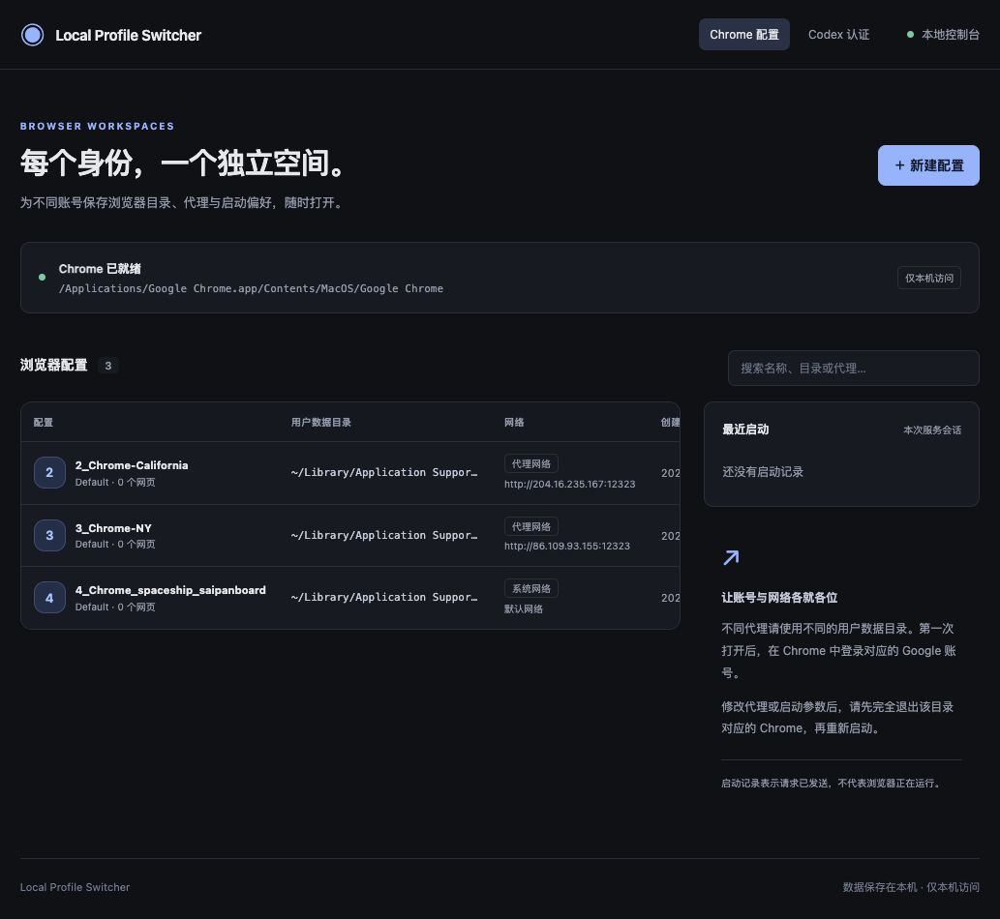
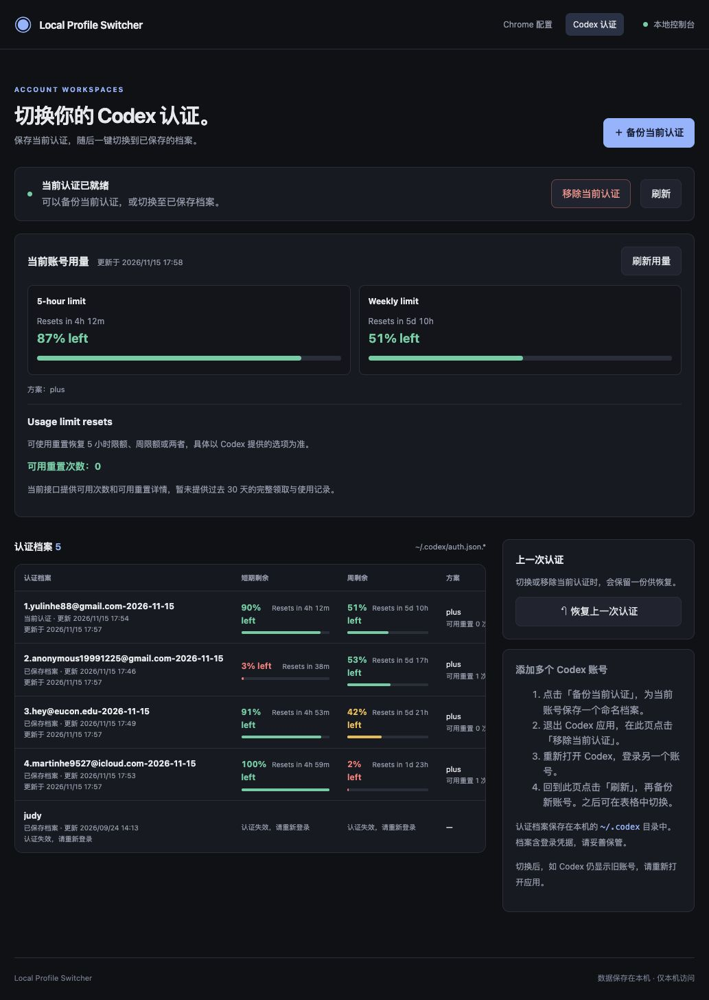

# Local Profile Switcher

一个仅在本机运行的网站，统一管理 Chrome 配置和 Codex 认证档案。无需第三方 Python 依赖。

## 启动

```sh
cd ~/github/local-profile-switcher
make dev
```

打开 http://127.0.0.1:8767/ 。Chrome 配置在首页；Codex 认证在 `/auth`。按 Ctrl+C 停止服务。可使用 `make dev PORT=9000` 更换端口。

- Chrome 配置保存在本目录的 `profiles.db`，已从原项目复制；原项目数据库仍保留。创建、编辑、启动会更新表格中的时间。
- Codex 认证仍使用 `~/.codex/auth.json` 和 `~/.codex/auth.json.名称`。Python 后端直接完成备份、切换、恢复、重命名、删除；SQLite 不保存认证内容。
- 两类操作都由同一个只监听 `127.0.0.1` 的服务处理。不要将服务反向代理到公网。

原 `chrome-profile-switcher` 和 `CodexAuthSwitcher` 项目未删除。认证切换后，如 Codex 仍显示旧账号，请重启 Codex 应用。

## 页面截图

### Chrome 配置



### Codex 认证与剩余额度



截图展示本机页面在截图时的账号档案、网络配置与用量状态。

## Codex 账号管理

认证页支持备份、切换、恢复、重命名、删除命名档案，以及移除当前 `auth.json`。

添加多个账号的步骤：

1. 登录 Codex，在认证页点击「备份当前认证」并保存命名档案。
2. 退出 Codex 应用，点击「移除当前认证」并确认。
3. 重新打开 Codex，登录另一个账号。
4. 回到认证页点击「刷新」，再备份新账号。之后可从表格切换。

移除当前认证会将其保留为「上一次认证」，覆盖原恢复记录。已命名的备份保留。

## Codex 用量

用量查询需要本机安装 Codex CLI，并确保服务进程可以执行 `codex`。可通过环境变量 `CODEX_BIN` 指定可执行文件路径。

后端通过 Codex App Server 查询每个认证档案的用量。页面显示 5 小时及周窗口的剩余百分比、剩余额度条、重置倒计时和可用重置次数。当前账号的用量每分钟刷新，表格在页面加载或点击「刷新」时查询。认证失效时会提示重新登录并更新备份。

可用重置详情包含服务端提供的领取、到期时间。当前接口没有提供过去 30 天完整的领取与使用历史。

## 验证

```sh
make test
```
